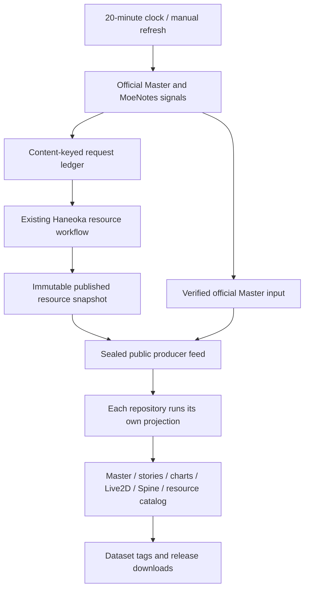

# Our Notes Data Pipeline

Independent data products for **BanG Dream! Our Notes**, maintained by [Haneoka](https://haneoka.org).

| Repository | Contents |
| --- | --- |
| [ournotes-masterdata](https://github.com/haneoka-gakuen/ournotes-masterdata) | Complete decoded production Master tables for JP and Intl |
| [ournotes-stories](https://github.com/haneoka-gakuen/ournotes-stories) | Readable plain-text stories in speaker-and-dialogue form |
| [ournotes-charts](https://github.com/haneoka-gakuen/ournotes-charts) | Original scores, readable JSON scores and song/difficulty tables |
| [ournotes-live2d](https://github.com/haneoka-gakuen/ournotes-live2d) | Complete portable Cubism models, textures, motions, expressions and physics |
| [ournotes-spine](https://github.com/haneoka-gakuen/ournotes-spine) | Spine skeletons, atlases, textures and their source relationships |
| [ournotes-resource-catalog](https://github.com/haneoka-gakuen/ournotes-resource-catalog) | Complete resource inventory with paths, sizes, media types and SHA-256 hashes |

Each data repository contains its usable data. The root `manifest.json` is its single version record. `version` is the numeric generation announced by the Master service; `hash` is its separate content identity. Operational state lives in Haneoka's private `private/companion-data/` R2 namespace. Public sealed feed pointers live on Haneoka's `companion-feeds` branch; probe history and dispatch receipts stay outside the data repositories.

## Update graph

The additive [`resource-companions.yml`](https://github.com/haneoka-gakuen/haneoka/blob/main/.github/workflows/resource-companions.yml) workflow in Haneoka runs this code at a pinned commit. The runner uses the existing JP/Intl configuration to publish a hash-verified public feed containing Master tables, Spine dependency metadata, the resource manifest and complete compressed model archives. Model archives are produced directly from R2 and reused by model content identity, avoiding per-file website traffic. Each data repository independently consumes that feed using its own short-lived `GITHUB_TOKEN`. The producer uses its own token to publish feeds and request resource builds. The existing resource workflows and website data sources retain their current responsibilities.

### Signals and loop prevention

1. Every 20 minutes, read the official Master service and MoeNotes' production version document. JP and Intl remain separate datasets; Intl retains the translations shipped in its tables and scripts.
2. Export all decoded official tables as one complete Master generation. Master and asset versions are independent, especially on JP.
3. Normalize the external signal to content/version fields. Changes to probe timestamps, README files or unrelated website code do not request a build.
4. Compare official Master with the Master inside the current published resource snapshot. Request a normal resource refresh when Master is ahead, or when the normalized external resource signal changes.
5. Store the dispatch intent in the private control namespace before calling GitHub. A content key receives at most three attempts, at least eight hours apart. Any active resource run coalesces further requests. A manual `retry` resets this budget.
6. A successful resource run publishes a sealed feed. Each domain repository checks its feed every 20 minutes and supports manual refresh. Completion events never request another resource build. Dataset pushes and release tags only publish downloads.
7. Failed probes preserve the last complete dataset. Each projection publishes independently, so one failing exporter does not block the others. GitHub marks the run failed and retains the error in control state.

External repositories act as update signals. Official Master bytes and Haneoka's hash-verified published resources provide the data. This keeps source ownership clear and avoids copying MoeNotes' operational records into our datasets.

## Publication contract

- `jp/` and `intl/` contain complete data for each product's stated scope.
- A dataset digest hashes sorted `{path, sha256, bytes}` records, using UTF-8 JSON with sorted keys, two-space indentation and a final newline.
- Content files enter a temporary `ingest/<server>` branch in bounded transfers. `main` advances only after every file and the root manifest are committed.
- Data tags follow the readable four-part Master generation: `jp-1.1.0.200` and `intl-1.1.0.200`. Master content hashes stay in the single version manifest; a hash suffix distinguishes changes within one generation.
- Releases contain complete server archives and `SHA256SUMS`. Streaming compression writes ordered parts up to 1 GiB directly, keeping temporary disk use bounded. Archive metadata is normalized for reproducible downloads.
- Story archives contain readable TXT files. Model archives contain only standard descriptors and their referenced resources. Repository documentation stays outside these downloads.
- Files remain in ordinary Git. Model descriptors use local relative references; model binaries retain their source bytes.
- A no-change reconciliation produces no data commit or tag.

## Operations

Run **Companion data synchronization** in Haneoka Actions. Choose `all`, `jp` or `intl`. Use `retry` after resolving a repeated upstream/build failure. Use `no_dispatch` to refresh companion repositories without requesting a resource build.

The producer runner needs the existing `resource-jp` / `resource-intl` environment configuration and R2 credentials. It reads published resources, writes control state only under `private/companion-data/`, publishes sealed feed assets in Haneoka Releases, and updates the public `companion-feeds` branch. It never promotes or deletes resource objects.

Every workflow uses its own repository-scoped `GITHUB_TOKEN`. Domain workflows need `contents: write`; the producer also needs `actions: write` for resource dispatch. **No cross-repository PAT, deploy key or copied CLI login is required.** Organization deploy-key restrictions therefore do not affect operation.

For an immediate update, first run the producer in Haneoka, then run **Synchronize data** in the desired domain repository. Scheduled runs handle both steps automatically. Use the domain release workflow's manual `tag` input to repair a failed archive upload for an existing immutable tag.

`discovery.py` reads official Master and external signals; `feed.py` owns sealed feeds and bounded build requests; `public_snapshot.py` verifies public input; `exporters.py` owns domain projections; `consume.py` runs inside each domain repository; `git_store.py` owns atomic publication. `release.py` and `model_package.py` ship inside the data repositories for standalone downloads and model packaging.

## Gradual processing migration

The first stage publishes independent products from existing immutable resource releases. The next stage can move individual domain producers behind the same input/output contracts: first story and score processing, then Live2D and Spine extraction, then bundle/media processing. Each move needs a complete input manifest, deterministic output manifest, processor version, dependency closure and a comparison with the current producer. Consumers can switch one product at a time after output parity is established.

Additional useful products include announcements, localized game text, audio cue/voice transcripts, song metadata and event calendars. Their content can be separated when they gain an independent consumer or processor; resource inventory already covers their discovery.

## Rights

Automation and helper code are licensed under MIT. Game text, scores, artwork and models retain their original rights; the code license applies to the tools. See each data repository's `NOTICE.md` for content attribution. Cubism Core and Spine runtime SDKs are supplied by the consuming application under their respective licenses.
